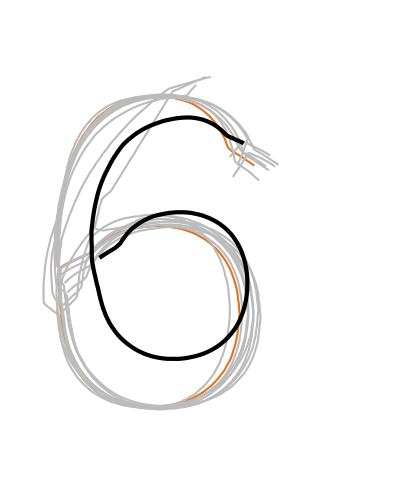
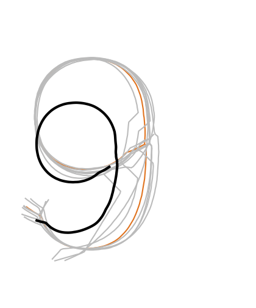
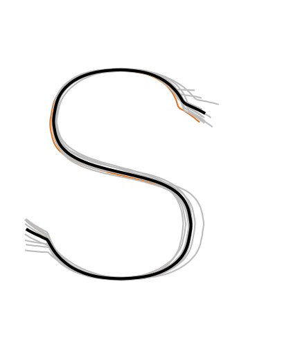
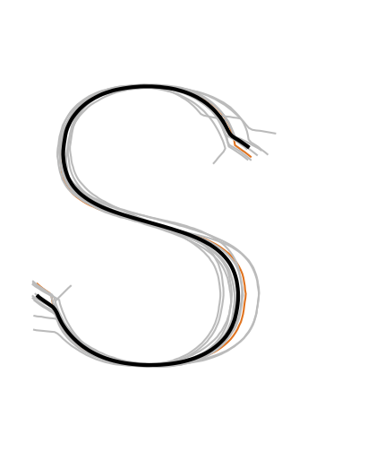

# Shape research: 6, 9, s and S

These four letters are a single movement of the pen, and they are where a
drawn-by-eye grotesque most often looks unnatural. So instead of drawing them
by eye, Litt Grotesk takes their centre lines from a study of how the best
grotesques draw them.

## Method (`proof/research.py`)

1. **References** at weight 400: TeX Gyre Heros (an open Helvetica clone),
   Inter, Geist, IBM Plex Sans, Roboto, Public Sans, Hanken Grotesk,
   Schibsted Grotesk, Instrument Sans, Work Sans, Archivo.
2. **Centre line.** Each glyph is rasterised 900px tall, thinned to a one-pixel
   skeleton, and walked from its terminal the way a pen moves (a 6 carries on
   down its left side at the junction, a 9 up its right side).
3. **Cohort.** Only fonts that draw the shape the Swiss way are averaged. For the
   6 and 9 that means a curved arc into the bowl; IBM Plex, Roboto and Hanken
   use a straight diagonal, a different tradition. Traces that stop early (a
   spur at a cut terminal) are dropped automatically. Every cohort includes
   Helvetica.
4. **Landmark alignment.** Each path is cut at the same structural points
   (terminal, top, leftmost, bottom, rightmost, bowl top, end) and each span is
   resampled, so like is averaged with like. Terminal ends are trimmed where
   the skeleton forks into a cut's corners.
5. **Fit.** The average is fitted with one cubic per span, with extremes kept
   level or upright, and saved to `data/consensus.json`. It is the genre's
   shared shape, not any one font's drawing.

The overlays in this folder show every reference's centre line (grey,
Helvetica in orange) and the average (black).

|  |  |  |  |
| --- | --- | --- | --- |

## Findings

| | Cohort | Width / height (centre line) | Key proportions |
| --- | --- | --- | --- |
| **6** | Helvetica, Inter, Public Sans, Archivo | 0.61 | widest at 49% of the height; bowl top at 60%; the arc's terminal ends at 90% |
| **9** | Helvetica, Inter, Public Sans, Instrument Sans, Archivo | 0.62 | widest at 50%; bowl bottom at 41%; not a rotated 6 |
| **s** | 7 of 11 | 0.67 | shoulders at 76% and 25%; spine runs about 15° at its centre |
| **S** | 6 of 11 | 0.66 | shoulders at 76% and 26%; spine about 15° at its centre |

## What Litt does with it

- The centre lines are scaled into Litt's own widths (tabular figures, its s
  and S widths) and drawn with Litt's pen (`geometry.pen`), so stroke weight,
  contrast and every master are Litt's.
- **Terminals stop a little earlier than the average**, nearer Helvetica's
  stopping point: the other fonts curl further, which closes the aperture.
- **Terminals are cut square to the stroke.** Helvetica cuts level, but with this
  skeleton a level cut leaves a sharp wedge at small sizes; square ends stay
  blunt and crisp in UI text, as in Inter and Geist.
- A 6 or 9's bowl closes on the side it leaves from, ending upright on that
  side's centre line, so the join has no step.

## Rerun

```bash
python3 proof/research.py <out_dir>          # traces and overlays (needs the reference fonts)
python3 -c "import sys,json; sys.path.insert(0,'proof'); import research as r; \
  json.dump({k:{'aspect':v['aspect'],'cubics':v['cubics'],'fonts':v['fonts']} \
  for k,v in r.consensus(json.load(open('<out_dir>/research.json'))).items()}, \
  open('data/consensus.json','w'), indent=1)"
```
